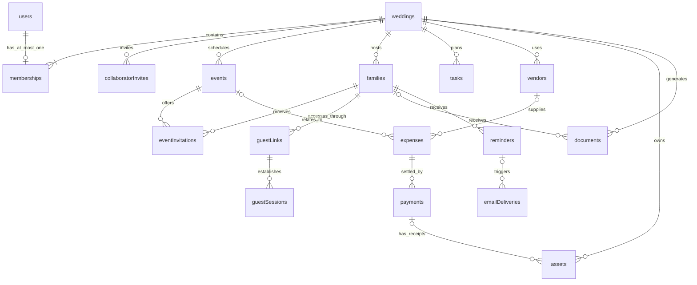

# MakeMyMarriage — Database Design, Version 1

**Status:** Approved design baseline; explicitly open policies remain unresolved. No database provisioned or migrations executed.  
**Version:** 1.0  
**Date:** 3 October 2026  
**Baseline:** [PRD 1.1](PRD-v1.md), [architecture 1.2](System-Architecture-v1.md), [user flows and screens 1.0](User-Flows-and-Screen-Map-v1.md)

## 1. Decisions and scope

Use one MongoDB database per environment on a transaction-capable replica set. Collections are shared across weddings; wedding-owned records contain `weddingId`. AWS S3 holds files; MongoDB holds metadata and authorization context. Do not put images, receipts, or PDFs into MongoDB documents or GridFS.

The design enforces the confirmed rules:

- Google-only workspace accounts; each account creates or joins at most one wedding.
- Multiple accounts may belong to one wedding as owner or viewer.
- Owners create/edit but cannot delete content, remove members, or demote owners. Viewers read only. There is no protected-couple role.
- Family guests have scoped access without accounts; RSVP is a total per invited event.
- One English Kankotri template, one page per included event, no cover page. Website templates remain separate.
- Immediate publication after photo processing, without approval or owner/guest removal controls.

Collection names and technical defaults below are proposals. Unconfirmed product rules, such as reminder timing and overpayments, remain marked open. This is a data contract for subsequent API design, not executable schema/migration code. No new AWS secrets, logging, or infrastructure-definition services are introduced.

## 2. Relationship map



RSVP is embedded in `eventInvitations`, not a second source of truth. Gallery photos and receipts use `assets` with distinct purposes. The diagram shows logical relationships; MongoDB does not enforce foreign keys or the diagram's minimum wedding-owner cardinality. Application transactions enforce them.

## 3. Common conventions

| Convention | Design |
|---|---|
| IDs | BSON ObjectId for application records/references; serialize as strings in APIs. Auth adapter mappings may require different physical identifiers. |
| Base fields | `_id`, `createdAt: Date`, `schemaVersion: Int32`; mutable collections also have `updatedAt: Date`, `version: Int32 >= 1`. Append-only records omit mutable fields. |
| Wedding scope | `weddingId: ObjectId` required for all wedding-owned records. Global identity/session collections are exceptions. The wedding root uses `_id`. |
| Optional fields | Omit absent optional values, unless a specific invariant calls for `null`. Do not mix empty strings/null/missing casually. |
| Dates | Instants are BSON Date in UTC. Date-only wedding/payment/task dates are ISO `YYYY-MM-DD` strings, validated as real calendar dates. IANA timezone is stored for interpretation. |
| Money | BSON Int64 `Long` in minor units. Services use exact integer arithmetic; API represents minor units as decimal strings. No floating-point money. Currency code and scale belong to wedding configuration. |
| Counts | BSON Int32 for attendance and versions; positive invited size, nonnegative attendee count. Product limits are configurable, not implicitly 500. |
| Text | Trim input, use plain text rather than arbitrary HTML. Apply field-length limits in runtime schemas and database validators. |
| Emails | Keep display value and normalized matching value. Proposed normalization: trim and lowercase; do not strip dots or plus tags. Google provider identity, not email, defines account uniqueness. |
| Actors | `{kind: 'user'|'guest'|'system', id?: ObjectId}`. For guests, ID is a guest session, never the raw token. Creation/update actors are server-derived. |
| Updates | Server-controlled allowlist, `expectedVersion` checks, immutable `_id/weddingId` and references unless explicitly allowed. Never accept a generic MongoDB update from a client. |
| Arrays | Embed only bounded value sets. Do not embed expanding members, events, photos, payments, job attempts, or audit history in parent documents. |
| Deletion | No `deletedAt`, `archivedAt`, or owner-controlled hidden state on business records. Access revocation and worker/retention states are distinct from owner deletion. |

Proposed validation caps: names/titles 120 characters, general notes 2,000, URLs 2,048. Invitation field limits may be tighter to fit a page; verify with the actual template before finalizing. These are technical guardrails, not confirmed product limits.

MongoDB validators can reject writes with invalid field types and values. They complement service authorization and cross-record checks rather than replace them. [MongoDB schema validation](https://www.mongodb.com/docs/manual/core/schema-validation/)

## 4. Identity and access collections

### 4.1 `users` — global application identity

| Field beyond base | Type / requirement |
|---|---|
| googleSubject | Required string; verified stable Google provider subject |
| email, emailNormalized | Required strings from verified provider identity |
| emailVerified | Required boolean; must be true for collaborator acceptance |
| displayName | Required string |
| avatarUrl | Optional validated provider URL |
| lastLoginAt | Optional Date |

Unique `googleSubject` prevents one Google identity becoming multiple app accounts. Email is a contact/matching attribute, not a way to reset membership. On Google profile/email change, update the same user. No password hash, protected-owner field, or wedding array.

**Auth integration boundary:** These are logical requirements. If the selected library stores provider accounts separately, put the unique `(provider, providerAccountId)` constraint there and map it one-to-one to `users`; do not maintain two conflicting identity authorities. Select an adapter that supports required session lifecycle controls, then document its physical collection mapping before implementation. Do not request/store Google API refresh tokens unless a real feature requires them; none currently does.

### 4.2 `authSessions` — global workspace sessions

Required logical fields: `userId`, `sessionTokenHash`, `expiresAt`; optional `revokedAt`, `lastSeenAt`. Authentication is Google-only; sessions are not login email tokens. Check expiry and revocation on every use, independent of background expiry cleanup. Physical names and secure token representation must match the chosen auth library rather than modifying an adapter blindly.

### 4.3 `memberships` — one wedding per account

| Field | Type / requirement |
|---|---|
| weddingId, userId | Required ObjectIds |
| role | Required enum `owner | viewer` |
| joinedViaInviteId | Optional collaborator invite ID; absent for creator |
| joinedAt | Required Date |

**Unique index on `userId` globally**, not just `(weddingId,userId)`. This is the central single-wedding invariant. Membership `weddingId/userId` are immutable. Only role transition allowed through owner actions is `viewer → owner`. No member deletion, owner demotion, leave flow, or reassignment.

### 4.4 `collaboratorInvites`

Fields: `weddingId`, `email`, `emailNormalized`, `role: owner|viewer`, `invitedByUserId`, `status: pending|accepted|revoked|expired`, `tokenHash`, `tokenCiphertext`, `keyVersion`, `expiresAt`, optional `acceptedByUserId/acceptedAt`, optional `revokedAt`.

Store the encrypted token only while needed for queued email delivery/retries; clear encrypted material after terminal state and retain metadata/hash according to retention policy. Queue messages contain invite IDs, not tokens. Encryption keys remain outside MongoDB in server runtime configuration.

One pending invitation per `(weddingId,emailNormalized)` through a partial unique index. Before reissuing an expired pending row, atomically mark it expired and insert the replacement. Revocation affects unaccepted invitations only. Accepting requires matching verified Google email and no existing membership in another wedding. A duplicate same-wedding acceptance cannot silently change a role.

## 5. Wedding, event, and family collections

### 5.1 `weddings`

| Field | Type / requirement |
|---|---|
| couple | Required fixed object: `bride.name`, `groom.name`; optional photo asset IDs and parents' names |
| weddingDate | Required date-only string |
| timezone | Required IANA timezone string |
| hostNames, welcomeText | Optional bounded text |
| createdByUserId | Required ObjectId; creator is an ordinary owner |
| currencyCode, currencyScale | Required string/integer before financial writes; INR/2 proposed, not finalized |
| budgetMinor | Optional nonnegative Long |
| rsvpDeadlineAt | Optional Date; required to schedule deadline-relative reminders |
| policies | Bounded object: configured guest edit cutoff, reminder offsets/recipient rule, storage policy IDs; only populate agreed policies |
| website | Bounded object: `templateKey`, `state: draft|published`, optional `slug`, `publishedAt`, `publishedRevision` |
| youtubeVideoId | Optional wedding-wide stream identifier |
| contentRevision | Required Int32; changes when shared PDF/website content changes |
| scheduleRevision | Required Int32; changes when wedding-wide reminder/deadline policy changes |
| accessVersion | Required Int32 for access-related cache/session checks |
| lifecycleState | Required `active | operationallyRestricted`; not editable by owners |

Do not embed event or member lists. Template registries live in application code; Kankotri key is fixed `english-event-v1` and is not a user selection. Website has its own allowlisted template keys. Public slug is optional until publication and unique only where present. Website publication rechecks that referenced assets are explicitly approved for public use; private gallery/receipt assets cannot become public through a field change.

### 5.2 `events`

Fields: `weddingId`, `name`, optional `description`, `startsAt: Date`, optional `endsAt: Date`, `timezone`, `venue: {name, address, latitude?, longitude?, mapsUrl?}`, optional `coverAssetId`, optional allowlisted `themeKey`, optional `youtubeVideoId`, `scheduleRevision: Int32`, creation/update actors.

Latitude and longitude appear together, are numeric and finite, and are bounded to [-90,90] and [-180,180]. No geospatial index is necessary for displaying a map link; nearby-venue search is not a feature. Validate `endsAt >= startsAt`. The event timezone initially copies the wedding timezone; changing wedding timezone must not silently shift saved event instants. Coordinates, address, and map link are presented for owner review rather than guessing a venue from a link.

Order events by `(startsAt,_id)`. No cancel/delete/archive state is invented. Timing edits increment event schedule and wedding content revisions in the same transaction.

### 5.3 `families`

Fields: `weddingId`, `displayName`, `nameSearch`, `invitedSize: Int32 >= 1`, `side: bride|groom|shared`, optional `contact: {name?, email?, emailNormalized?, phone?}`, `reminderPreference: enabled|disabled`, `preferenceRevision: Int32`, `contactRevision: Int32`, `invitationRevision: Int32`, optional `importId/importRowKey`, creation/update actors.

One record per household. Names, phone numbers, and emails are not unique: relatives may share a contact and different families may have the same name. Duplicate detection in import is advisory. No mandatory individual-person collection is needed; named-person functionality can be designed later if requested. The sum of invited sizes describes people; the number of documents describes families.

Changing contact email increments `contactRevision` to invalidate stale pending email content. `version` is also the concurrency guard shared by family-size, eligibility, RSVP, and link-management operations where required.

### 5.4 `eventInvitations` — eligibility and RSVP together

| Field | Type / requirement |
|---|---|
| weddingId, familyId, eventId | Required ObjectIds; unique combination |
| invited | Required boolean; false withdraws eligibility without deleting the record |
| eligibilityRevision | Required Int32, increment on invitation-set changes |
| rsvp.status | Required `pending | attending | declined` |
| rsvp.attendeeCount | Int32 or explicit null: pending=null, declined=0, attending>=1 |
| rsvp.respondedAt | Date for answered status; absent for pending |
| rsvp.actor | Actor for answered status |

An attending count cannot exceed current `families.invitedSize`. Both guest and owner corrections use the same count validation. Only `invited=true` rows appear in guest views, PDFs, event totals, or reminder eligibility. Withdrawing eligibility preserves the previous response for history and updates revision numbers. Reinvitation policy remains open: recommended reset to pending with the previous response recorded in audit, rather than assuming old attendance still applies.

No separate `rsvps` collection or increment-only headcount counter. RSVP updates replace an event response. Audit records preserve changes rather than adding an unbounded response-history array.

### 5.5 `guestLinks`

Fields: `weddingId`, `familyId`, `purpose: invitation|reminderPreferences`, `status: active|revoked|expired`, `tokenHash`, encrypted `tokenCiphertext`, `keyVersion`, `generation: Int32`, optional `expiresAt`, optional `revokedAt`, creation actor.

One active link per `(weddingId,familyId,purpose)` enforced by a partial unique index. Ordinary invitation links can create guest sessions. A `reminderPreferences` link can only read/update the family's reminder preference; it must not open the invitation, gallery, or workspace. It has an expiry chosen in technical policy. Email rendering resolves the current appropriate link by purpose.

Replace/revoke a compromised link in a transaction, preserving old metadata. Existing sessions refer to its link ID/generation and become invalid when that link is revoked. Encryption is needed for owner re-sharing and automated messages, while hashing is used for lookup/verification. Never expose hashes/ciphertexts in ordinary API objects. Key rotation, expiration, and access checks are described in the architecture.

### 5.6 `guestSessions`

Fields: `weddingId`, `familyId`, `guestLinkId`, `linkGeneration`, `sessionTokenHash`, `expiresAt`, optional `revokedAt`. No `userId` or membership is required. Before use, check session expiry, matching active invitation link, current family/wedding, and requested event eligibility. Logging into Google must not transform this capability into workspace membership.

## 6. Planning and finance collections

### 6.1 `tasks`

Fields: `weddingId`, `title`, optional `description`, optional `assigneeUserId`, optional `eventId`, optional `dueDate` (date-only), `status: todo|done`, optional `completedAt/completedByUserId`, optional `starterTaskKey`, actors.

Assignee must be a member of this wedding. Assignment does not change role permissions. `done` requires completion metadata; reopening to `todo` clears current completion fields and records audit history. Starter task key is unique within a wedding when present, preventing repeated checklist insertion. Overdue is derived from the wedding timezone and date, not stored as a mutable status. No delete/archive action.

### 6.2 `vendors`

Fields: `weddingId`, `name`, `nameSearch`, `categoryKey`, optional `contactPerson/phone/email/notes`, optional bounded `eventIds[]`, actors. Validate all event references and reject duplicates. Category uses an application-defined allowlist initially. Do not introduce a marketplace or a global shared vendor record. Expenses reference vendors; editing a contact does not rewrite payment history.

### 6.3 `expenses`

| Field | Type / requirement |
|---|---|
| weddingId | Required ObjectId |
| title, categoryKey | Required strings |
| vendorId, eventId | Optional same-wedding references |
| amountMinor | Required nonnegative Long; proposed draft-friendly zero permitted |
| paidMinor | Required nonnegative Long; transactionally maintained cache, never client editable |
| dueDate | Optional date-only string |
| notes | Optional bounded text |
| createdBy, updatedBy | Actors |

All expense/payment amounts use the wedding currency; there is no independent per-payment currency or conversion. Outstanding is `amountMinor - paidMinor`. Overpayment rejection is proposed; do not finalize it merely by including the field. If adopted, expense reductions below paid total fail, and payment changes enforce the same bound.

### 6.4 `payments`

Fields: `weddingId`, immutable `expenseId`, `amountMinor: Long >= 0`, `paidOn` date-only, `payer: {name, userId?}`, optional notes, `creationRequestKey`, actors. If present, payer user ID belongs to this wedding; free-text payer supports relatives without accounts. Receipt assets reference the payment instead of an expanding receipt-ID array.

Proposed validation: new payments must be positive. Editing a mistaken payment to zero is an explicit open product decision; zero is representable so the schema does not force invented deletion/voiding. Such a correction retains the record and audit trail. Until approved, service logic rejects it. Do not move a payment to a different expense through a generic edit; correction of a wrong expense association is another finance-policy decision.

Payment sums are authoritative; `expenses.paidMinor` is a checked cache updated in the same transaction as every payment creation/correction. Do not infer payments from uploaded receipts.

## 7. Assets and generated documents

### 7.1 `storageQuotas`

One row per wedding: `weddingId`, `limitBytes: Long`, `usedBytes: Long`, `reservedBytes: Long`, `policyVersion`. All counters nonnegative. Limits are operational configuration, not user-approved figures yet. No free-unlimited assumption. Atomically reserve capacity before issuing upload grants. Count all retained variants, optional originals, and generated PDFs. Infrastructure logs do not consume the wedding file quota.

### 7.2 `assets`

| Field | Type / requirement |
|---|---|
| weddingId | Required ObjectId |
| purpose | `galleryPhoto | receipt | eventCover | couplePhoto | generatedPdf | importSource | exportFile | publicWebsiteCopy` |
| uploader | Actor; guests permitted only for galleryPhoto |
| familyId | Required for guest gallery upload; does not make the photo family-private |
| paymentId | Required for receipt; immutable same-wedding target |
| documentId | Required for generatedPdf |
| sourceAssetId | Required for publicWebsiteCopy; publication validates source purpose |
| state | `pending | processing | ready | failed | expired | operationallyRestricted` |
| staging | Optional bounded object: bucket, key, upload expiry, checksum/version information |
| variants | Bounded array of named file variants: bucket, key, mimeType, bytes, checksum, optional width/height |
| quotaReservation | Reserved bytes, reservation expiry, state `reserved|settled|released` |
| processingJobId, processingFence | Optional current job ID and fence; required when a worker claims processing |
| readyAt, failedAt, failureCode | Optional system fields appropriate to state |
| retentionExpiresAt | Optional operational policy; never directly TTL-delete asset metadata |

Store immutable final object keys and content checksums, not signed URLs or file blobs. Restrict purpose fields with discriminated schemas; e.g., a receipt cannot also be a gallery photo. Owners cannot repurpose an existing private asset as public through editing its purpose.

Private downloads authorize the parent record and purpose. Ready gallery photos are visible wedding-wide to guests; receipts remain member-only. Public copies are distinct assets created only from specifically publishable couple/event website content. Master PDFs require membership; family PDF access requires matching family or membership.

Use the same validated byte snapshot for processing and publication, as described in the architecture. Conditional worker completion prevents a stale processing task from restoring operationally restricted content. `operationallyRestricted` is not an owner hiding control. Unused/superseded private asset cleanup requires the retention policy, not an owner-triggered delete shortcut.

### 7.3 `documents`

Fields: `weddingId`, `scope: master|family`, conditional `familyId`, `templateKey: 'english-event-v1'`, `templateVersion`, `sourceRevision`, conditional `familyInvitationRevision`, `generationKey`, `status: queued|rendering|ready|failed|stale`, `eventIds[]`, `pageCount`, optional `assetId`, optional `failureCode`, `requestedByUserId`, `jobId`.

`eventIds` is a bounded render snapshot, not a second editable event list. `pageCount` must equal included-event count; zero-event generation is rejected. No cover page and no language selector. Use a consistent source snapshot. `generationKey` is a hash of canonical wedding/scope/family/revision/template inputs; it deduplicates identical requests. Compare current revisions both before publication and download. An event withdrawn from a family's eligibility cannot remain accessible through a newly issued PDF link.

A ready row is still stale if revisions differ, even if a background process has not updated its status. Capture content during the job from a consistent database snapshot; do not retain a second permanent editable copy of the wedding's full personal data. Rendered S3 PDF is the immutable output.

## 8. Operational collections

These support existing features; they are not additional user-facing modules. Introduce them with their implementation milestones rather than building an entire job platform before the core wedding flow.

### 8.1 `reminders`

Fields: `weddingId`, `familyId`, conditional `eventId` (required for event reminders), `kind: rsvp|event`, `logicalKey`, `dueAt`, `validUntil`, `scheduleRevision`, conditional `eventScheduleRevision`, `contactRevision`, `preferenceRevision`, `status: scheduled|queued|completed|skipped|failed`, optional `skipReason`, optional `jobId/emailDeliveryId`.

Logical key includes family, kind, relevant event, and logical schedule occurrence. New schedule versions may create new rows and mark old unsent rows skipped. Always recheck current eligibility at send time. Do not include every RSVP version in the unique key: editing a response must not generate repeated reminders for the same occurrence. Final reminder timing and late/revised-event policy determine `validUntil` and replacement rules before release.

### 8.2 `emailDeliveries`

Fields: `weddingId`, `logicalKey`, `kind: collaboratorInvite|rsvpReminder|eventReminder`, appropriate `inviteId/reminderId/familyId`, recipient email snapshot (restricted), `contactRevision`, `status: queued|sending|accepted|delivered|bounced|complained|failed|unknown|skipped`, optional `skipReason`, optional `providerMessageId`, bounded current-attempt metadata, optional `acceptedAt/deliveredAt/bouncedAt/complainedAt`, error code.

No open/read status. Preserve independent outcome timestamps so a delayed “accepted” event cannot overwrite a complaint or bounce. Unique logical key prevents ordinary duplicate sends. `sending` that loses its provider response becomes `unknown`, not automatically queued again. Configure SDK/provider retries accordingly; exactly-once external email delivery is not guaranteed by a database transaction. Feedback and logical-delivery correlation should use a nonsecret delivery ID.

Collaborator email dispatch checks the referenced invitation is still pending and unexpired. Do not send a consumed/revoked invitation, or attempt to decrypt token material already cleared at terminal state. Member access invitations and guest reminder opt-outs are separate message categories.

### 8.3 `jobs`

Fields: `weddingId` where applicable, `type`, `referenceId`, `idempotencyKey`, `status: queued|running|succeeded|failed|cancelled`, `attempt: Int32`, `availableAt`, optional `leaseOwner/leaseUntil`, `fence: Int32`, optional result reference and sanitized last error.

Atomic claim increments fence; only the current lease holder can finish. Retry changes attempt/availability. Do not embed unbounded attempt output or raw tokens. Logical side effects check their own uniqueness even after a queue job is replayed. Control/scheduler jobs may be global, with no wedding scope, and have explicitly restricted handlers.

### 8.4 `outbox`

Fields: `weddingId` where applicable, `jobId`, `dispatchGeneration`, `state: pending|publishing|published`, `availableAt`, optional `leaseOwner/leaseUntil`, `fence`, optional `publishedAt`.

Created with domain change/job in one MongoDB transaction. Dispatcher publishes reference IDs to SQS, then marks published. A crash can publish twice; consumer uses jobs/domain idempotency. A recovery sweep may create a new dispatch generation for a lost/expired execution instead of resetting history ambiguously. Never wrap external SQS or email calls inside a transaction callback that may retry.

### 8.5 `imports` and `importRows`

`imports`: `weddingId`, source asset ID, initiating user, `status: preview|committing|completed|failed`, validation/template version, row counts, expiry for temporary source, optional job ID.

`importRows`: `weddingId`, `importId`, `rowKey`, bounded normalized family data, validation errors, optional duplicate candidate IDs (bounded), `decision: pending|accept|skip`, `state: preview|committed|failed`, optional `familyId`.

Unique `(importId,rowKey)` plus family import-source key makes retry safe. Each accepted row commits family/eligibility creation and its committed marker together. Re-uploading the same file as a new import still requires duplicate review; row-key uniqueness alone cannot identify semantic duplicates across imports. Clean temporary source/preview payload only after the agreed retention window, retaining stable commit markers needed for retries.

### 8.6 `mutationRequests`

Fields: `weddingId` where applicable, `actorKey`, `operation`, `requestKey`, `payloadHash`, `resultType`, `resultId`, `completedAt`. Unique `(actorKey,operation,requestKey)`.

For retry-prone transactional mutations, insert completion record atomically with effects. Same key/same payload returns the saved result reference; same key/different payload is a conflict. No sensitive cached response body. Reauthorize on replay. Financial creation also stores a durable creation key on `payments` to survive a future idempotency-cache retention change. No automatic TTL until retry horizons are specified.

### 8.7 `auditEvents`

Append-only: `weddingId`, `actor`, `action`, `entityType/entityId`, `occurredAt`, `correlationId`, bounded allowlisted change details. Record membership promotions, invitation eligibility and RSVP changes, finance corrections, link rotation, and important publication changes. Never log raw token material, signed URLs, full receipts, or entire documents. Audit access is operational by default; a new audit-history UI is not part of V1. Retention and exceptional erasure policy must include these records.

## 9. Index catalogue

All collections already have a unique `_id` index. `U` means unique; `P` means partial. Compound key order below is deliberate. Add measured query indexes later rather than indexing every optional field.

| Collection | Additional indexes |
|---|---|
| users | U `{googleSubject:1}` (or adapter provider identity equivalent); `{emailNormalized:1}` for invitation lookup |
| authSessions | U `{sessionTokenHash:1}`; `{userId:1}`; TTL `{expiresAt:1}` with `expireAfterSeconds:0` |
| memberships | U `{userId:1}`; `{weddingId:1,role:1,_id:1}` |
| collaboratorInvites | U `{tokenHash:1}`; U/P `{weddingId:1,emailNormalized:1}` where status=`pending`; `{weddingId:1,status:1,createdAt:-1}` |
| weddings | U/P `{'website.slug':1}` where slug is a string |
| events | `{weddingId:1,startsAt:1,_id:1}` |
| families | `{weddingId:1,nameSearch:1,_id:1}`; U/P `{weddingId:1,importId:1,importRowKey:1}` where importId is ObjectId |
| eventInvitations | U `{weddingId:1,familyId:1,eventId:1}`; `{weddingId:1,eventId:1,invited:1,'rsvp.status':1}` |
| guestLinks | U `{tokenHash:1}`; U/P `{weddingId:1,familyId:1,purpose:1}` where status=`active` |
| guestSessions | U `{sessionTokenHash:1}`; `{guestLinkId:1}`; TTL `{expiresAt:1}` with `expireAfterSeconds:0` |
| tasks | `{weddingId:1,status:1,dueDate:1,_id:1}`; U/P `{weddingId:1,starterTaskKey:1}` where starterTaskKey is string |
| vendors | `{weddingId:1,nameSearch:1,_id:1}` |
| expenses | `{weddingId:1,dueDate:1,_id:1}`; `{weddingId:1,vendorId:1}` |
| payments | `{weddingId:1,expenseId:1,paidOn:1,_id:1}`; U `{weddingId:1,creationRequestKey:1}` |
| storageQuotas | U `{weddingId:1}` |
| assets | `{weddingId:1,purpose:1,state:1,readyAt:-1,_id:-1}`; `{weddingId:1,paymentId:1}`; `{'quotaReservation.state':1,'quotaReservation.expiresAt':1}` |
| documents | U `{generationKey:1}`; `{weddingId:1,scope:1,familyId:1,createdAt:-1}` |
| reminders | U `{logicalKey:1}`; `{status:1,dueAt:1,_id:1}`; `{weddingId:1,familyId:1,kind:1}` |
| emailDeliveries | U `{logicalKey:1}`; U/P `{providerMessageId:1}` where value is string; `{weddingId:1,createdAt:-1,_id:-1}` |
| jobs | U `{idempotencyKey:1}`; `{status:1,availableAt:1,_id:1}`; `{status:1,leaseUntil:1}` |
| outbox | U `{jobId:1,dispatchGeneration:1}`; `{state:1,availableAt:1,_id:1}`; `{state:1,leaseUntil:1}` |
| imports | `{weddingId:1,createdAt:-1,_id:-1}` |
| importRows | U `{importId:1,rowKey:1}`; `{weddingId:1,importId:1,state:1}` |
| mutationRequests | U `{actorKey:1,operation:1,requestKey:1}` |
| auditEvents | `{weddingId:1,occurredAt:-1,_id:-1}` |

Names can be searched with escaped, normalized prefix matching and bounded results; arbitrary regex/substring search is not assumed to use these indexes. No initial sharding or Atlas Search dependency. A future sharding design must revisit the global `userId` uniqueness requirement rather than shard memberships by wedding and assume that invariant survives unchanged.

Unique indexes reject duplicates, including under concurrent writes. Optional unique fields need partial indexes so missing values do not collide; a plain unique single-field index treats missing/null as an indexed value. Partial queries must match the index filter to use it appropriately. [Unique indexes](https://www.mongodb.com/docs/manual/core/index-unique/), [partial indexes](https://www.mongodb.com/docs/manual/core/index-partial/)

TTL cleanup is asynchronous. It is appropriate for expired session records, not for immediate access denial or coordinated S3 deletion. No TTL on business collections, memberships, financial records, or ready assets. [MongoDB TTL indexes](https://www.mongodb.com/docs/manual/core/index-ttl/)

## 10. Validation and enforcement boundaries

| Rule | Primary enforcement |
|---|---|
| One Google identity per account | Provider identity uniqueness + verified authentication |
| One wedding per account | Global unique membership userId + create/join transaction |
| Same-wedding references | Domain service lookups scoped by weddingId; not a foreign-key constraint |
| Owner/viewer/guest permissions | Current session/membership and purpose-scoped services on every request |
| No owner deletion or demotion | No delete/demotion API; update allowlists and service checks; owners never receive DB credentials |
| RSVP status/count shape | Validator for pending/null, declined/0, attending/positive; family maximum in transaction |
| Money exactness | Long values, exact arithmetic, amount bounds, currency policy and transaction |
| File purpose and parent | Discriminated validator + same-wedding and ready-state authorization |
| Valid links/timezones/dates | Runtime semantic validators plus type/length checks in DB |
| Immutable weddingId/references | Service allowlists; database validators alone do not compare old/new state |
| Single active token/invite slot | Partial unique indexes plus explicit transitions |
| Idempotent effects | Unique keys, persisted mutation results, transactions, fenced worker writes |

Apply strict database validation to new application collections and reject unknown fields where schema maintenance allows; include `_id` and common fields in those schemas. Use discriminated rules for token purpose, asset purpose, and RSVP state. Auth-library-owned collections follow adapter-supported schemas. Validators cannot determine that an HTTP caller is an owner or prevent every bad transition based only on the new document.

## 11. Transaction and race-condition design

Transactions use the driver's supported retry mechanism, snapshot reads where needed, and majority-acknowledged commit for cross-document invariants. Keep them short; do not render files, upload to S3, or call providers inside the transaction. Unique violations become meaningful application conflicts, not generic server errors. Multi-document transactions require a supported deployment, so use a replica set in local integration testing too. [MongoDB transactions](https://www.mongodb.com/docs/manual/core/transactions/)

### T01 — Create wedding / accept collaborator invitation

Create wedding: recheck Google identity → insert wedding, owner membership, quota row, mutation result → commit together. Unique membership failure aborts the wedding creation. Repeating the same request returns its original result.

Accept invitation: check token, email, expiry/status → check membership → insert membership and mark invite accepted → commit. Existing same-wedding membership yields an explicit already-joined result without role change. Another wedding produces a conflict. Two concurrent accepts cannot assign two memberships. Viewer promotion uses `role=viewer` and expected version as its update predicate; demotion/removal has no service path.

### T02 — RSVP, family size, and eligibility

RSVP transaction loads family and current invitation rows, validates counts/permission/deadline, and performs a real version increment on the family concurrency guard. Family-size and eligibility changes touch that same guard, so concurrent changes conflict and retry against current data. Also touch/read the wedding schedule guard through a versioned update when validating a changeable deadline; a read alone does not serialize a deadline edit. All submitted event responses commit together with audit; omitted events remain unchanged under the proposed partial-response UX.

Update each response with its expected version to expose stale user edits rather than silently overwrite. Multi-event transactions bound request size. Lock/update shared records in consistent order: wedding, family, then sorted event-invitation IDs. Family-size reduction validates every current invited attending count before committing. Eligibility changes retain rows, increment family invitation revision, and schedule reconciliation in outbox.

### T03 — Expense/payment correction

Read expense and its current version; insert or update payment; compute delta against previous payment amount; conditionally update expense paidMinor and version; insert audit and idempotency result; commit. Bound amount and paid totals under the agreed overpayment policy. Concurrent writes to the expense conflict, so both payments cannot independently spend the same remaining balance. Expense amount edits use the same guard. The immutable expense reference prevents moving a payment without accounting for both sides.

Periodically compare payment sums with the cache. Investigate discrepancies; repair using a guarded transaction, not an unscoped bulk overwrite. No deletion/void status is added to fix mistakes; unresolved correction policies stay open.

### T04 — Upload reservation and completion

Reserve estimated maximum retained bytes in storageQuotas with a conditional capacity update, create pending asset, and commit before issuing a grant. Process the exact validated staging bytes outside a transaction. Publication atomically transitions the asset from processing to ready and settles quota once, checking worker fence and reservation state. If actual output exceeds reservation, reserve the delta only if capacity permits before publishing. Repeated completion sees settled state and does not double-charge.

Abandoned uploads release reservations once; cleanup removes staging objects through S3 operations with retry records. S3 and MongoDB are not one transaction: a reconciler handles uploaded outputs left unreferenced by a failed completion. Processing must stop or fail publication after a reservation has expired/released or operational access has been restricted.

### T05 — PDF invalidation and publication

Changes to couple/event/template-relevant content increment weddings.contentRevision in the same transaction as the edit. Family eligibility changes increment families.invitationRevision. Family-PDF generation captures both; master PDF uses wedding revision only. Job reads a consistent snapshot and verifies revisions again at publication. To close a check-then-publish race, publication and content edits must conflict on shared guard writes (wedding/family version), not merely perform separate reads. Download checks current revisions again.

### T06 — Reminder scheduling and dispatch

Schedule/deadline/contact changes update their revision and create outbox work atomically. Dispatch loads current eligibility, RSVP, email, preference and policy; conditional claims prevent duplicate logical delivery. Include a family `preferenceRevision` integer, incremented on each preference change, alongside contactRevision. A suppressed recipient is skipped regardless of old queued contents. Update emailDeliveries before calling the provider, then record the response; ambiguous outcomes become unknown. A preference change cannot recall a message already handed to the provider.

Current-session/link validation still applies at request time. Database snapshots alone do not revoke an already issued signed S3 URL; the architecture's short-expiry limitation remains.

## 12. Representative records

MongoDB Extended JSON examples illustrate types and business states, not executable seed data. References stand for other records; all use the same wedding. Common creation metadata is abbreviated in these examples only.

```json
{
  "_id": {"$oid": "000000000000000000000301"},
  "weddingId": {"$oid": "000000000000000000000100"},
  "familyId": {"$oid": "000000000000000000000200"},
  "eventId": {"$oid": "000000000000000000000101"},
  "invited": true,
  "eligibilityRevision": 1,
  "rsvp": {
    "status": "attending",
    "attendeeCount": 4,
    "respondedAt": {"$date": "2026-10-03T09:00:00Z"},
    "actor": {"kind": "guest", "id": {"$oid": "000000000000000000000900"}}
  },
  "version": 2,
  "schemaVersion": 1
}
```

```json
{
  "_id": {"$oid": "000000000000000000000401"},
  "weddingId": {"$oid": "000000000000000000000100"},
  "title": "Wedding photography",
  "categoryKey": "photography",
  "amountMinor": {"$numberLong": "8000000"},
  "paidMinor": {"$numberLong": "2000000"},
  "version": 2,
  "schemaVersion": 1
}
```

With proposed INR/2 currency configuration, the second record means ₹80,000 committed and ₹20,000 paid; ₹60,000 outstanding is derived, not separately stored. A pending RSVP uses count null; it must not be counted as a declined response.

## 13. Read models, queries, and isolation

| Screen/query | Data and query rule |
|---|---|
| Post-login routing | Membership lookup by userId; then fetch that wedding |
| Event list | weddingId filter, sort startsAt/_id, cursor pagination |
| Family/RSVP overview | Paginate families by nameSearch/_id; lookup invitation rows with both weddingId and familyId |
| Guest events | Session-scoped family, only invited=true joins; explicitly project guest-safe event fields |
| Attendance totals | Group current invited rows by event/status; sum attending counts, count pending families separately |
| Expected invited people | Join current invited rows to families and sum invitedSize per event; do not sum event attendance as unique wedding guests |
| Budget dashboard | Sum expenses.amountMinor and paidMinor once; avoid unwinding payments and counting expense amounts multiple times |
| Vendor payments | weddingId/vendorId expenses, then scoped payment records |
| Gallery | weddingId, purpose=galleryPhoto, state=ready; sort readyAt/_id; issue authorized variant URLs |
| Receipt list | weddingId/paymentId and purpose=receipt; workspace access only |
| PDF download | Scope/family match + source revisions + ready asset; no generic guest asset-by-ID download |
| Due reminders | Internal status/dueAt index; worker scope checked per row |
| Public website | Allowlisted wedding fields and approved public copies; no family contacts or private event/gallery payloads |

Cursor values bind to the current wedding, sort, and filter; validate them and apply server scope regardless of cursor contents. Proposed list page size is 25, maximum 100. No separate dashboard collection in V1; compute from indexed source records at the expected scale. Validate plans with representative data before adding aggregate caches.

Every API lookup, update, and aggregation includes wedding scope. Cross-collection lookups also match weddingId rather than trusting an ObjectId. Unique global indexes do not authorize cross-wedding reads. Use server-only database credentials with minimum required collection privileges; separate operational erasure credentials from request handling. Do not grant a broad remove permission over business collections just to expire authentication sessions.

## 14. Lifecycle, migration, and validation plan

- Version schema changes and indexes as future migrations; do not create them on every request/startup. Check existing data for duplicates before adding unique indexes.
- Auth adapter mapping is a prerequisite for identity migrations. Do not hand-edit library tables without a supported adapter contract.
- Deploy backward-compatible additions first, backfill, enforce stricter validators after old writers are retired. Code rollback does not undo data changes.
- No owner-triggered record deletion. Session expiration, temporary-file cleanup, and separately authorized erasure procedures remain operational responsibilities.
- Define retention before enabling TTL on anything beyond sessions. Never expire ready-asset metadata before coordinating S3 cleanup and parent references.
- Backups must restore identity/membership constraints, monetary records, token-encryption key availability, and S3 metadata coherently. No key material is stored in this document or database.
- No production workload is being migrated now; this repository currently contains design documents.

### Required implementation verification

1. Concurrent create/join attempts leave exactly one membership and no orphan newly-created wedding.
2. Duplicate Google identity cannot create another application account; provider email changes retain membership.
3. Owners/viewers cannot delete records; owner demotion and member removal are rejected.
4. Cross-wedding event/payment/asset references and guest-to-receipt access fail.
5. Pending/null, declined/zero, positive attendance, family-size reductions, and simultaneous RSVP edits behave correctly.
6. Replayed payment creation and concurrent corrections produce exact totals without duplicates.
7. Missing optional slugs/import keys allow many rows; duplicate present keys fail as intended.
8. Expired but not-yet-TTL-deleted sessions cannot access data; preference links cannot create guest sessions.
9. Old PDF revisions fail download authorization; page count equals included events.
10. Upload completion/retry/expiry cannot double-charge quota or publish a replacement unvalidated object.
11. Stale reminder jobs are skipped, and ambiguous email delivery is not blindly retried.
12. Import retry preserves one family per accepted source row, with duplicate review across new imports.

## 15. Requirements coverage

| PRD requirement | Main collections |
|---|---|
| FR-01 Authentication/setup | users, authSessions, weddings, collaboratorInvites |
| FR-02 Roles/single wedding | memberships, users, collaboratorInvites |
| FR-03 Events | events, weddings, assets |
| FR-04 Families | families, eventInvitations, imports, importRows |
| FR-05 Kankotri | documents, assets, events, weddings, families |
| FR-06 RSVP | eventInvitations, families, guestLinks, guestSessions |
| FR-07 Reminders | reminders, emailDeliveries, families, guestLinks, jobs, outbox |
| FR-08 Tasks | tasks, memberships, events |
| FR-09 Vendors | vendors, expenses |
| FR-10 Finance | expenses, payments, assets, weddings, mutationRequests |
| FR-11 Dashboard | Indexed queries over events, tasks, families, eventInvitations, expenses |
| FR-12 Website | weddings.website, events, public-purpose assets |
| FR-13 Gallery | assets, storageQuotas, guestSessions |
| FR-14 YouTube | events.youtubeVideoId, weddings.youtubeVideoId |

Audit events support important mutations across modules. Operational collections do not grant a separate user-facing admin role or override the no-deletion policy.

## 16. Open decisions and next deliverable

| Topic | Position |
|---|---|
| Auth library | Google method is final; adapter physical collections and token handling require compatibility selection |
| Money policies | Currency, overpayment handling, zero-value corrections, and wrong-expense corrections require review |
| Reinviting an event | Retain previous response in audit; resetting current RSVP to pending is proposed |
| RSVP/reminder policies | Deadline rules, schedule offsets, replacement occurrences, and valid send window remain open |
| Asset limits/lifecycle | Formats, per-file/wedding limits, original retention, and operational removal remain open |
| Public website | Publication projection supported; final visibility/unpublish policy remains open |
| Hosting and recovery | Database tier, backups, encryption-key recovery, and operating costs remain technical deployment decisions |

The database design has been approved. The next deliverable is drafted in the [API Specification v1](API-Specification-v1.md) and its [OpenAPI contract](api/openapi-v1.json), using the field types, access rules, errors, idempotency keys, and version checks defined here. Create executable validators/migrations when implementation begins. Explicitly open product policies still require decisions; the PRD remains the authority for product scope.
