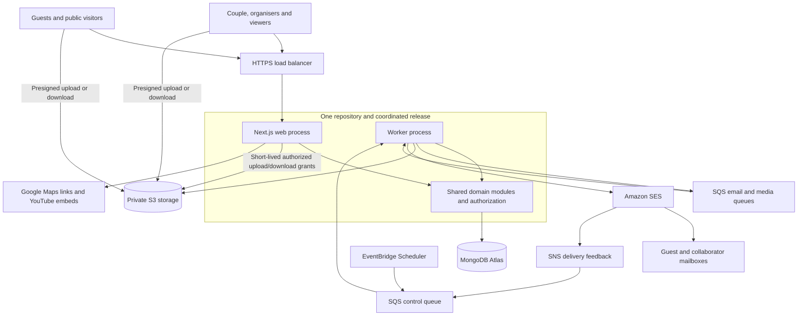
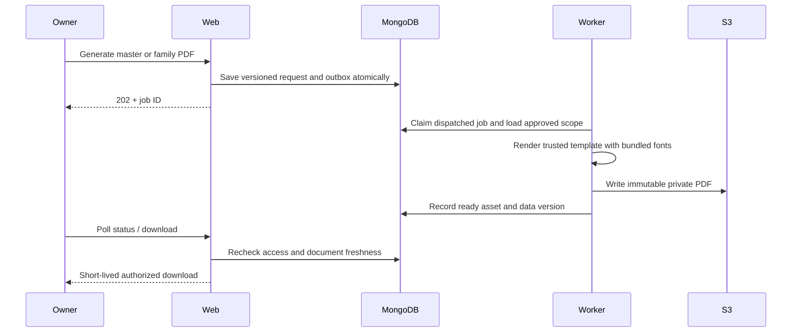

# MakeMyMarriage — System Architecture, Version 1

**Status:** Proposed architecture for review  
**Date:** 30 September 2026  
**Revision:** 1.2 — aligned with PRD 1.1 feature simplifications  
**Requirements baseline:** [Version 1 PRD, revision 1.1](PRD-v1.md), reflecting the product owner’s confirmed revisions; explicitly unresolved PRD defaults remain open.  
**Scope:** Architecture and design only. This document does not provision infrastructure or implement the application.

## 1. Architecture decision

Build a **modular monolith using Next.js and TypeScript**, with MongoDB for structured data and AWS S3 for files. Next.js supplies both the frontend and backend; a separate Express or NestJS API is unnecessary for V1.

Run two process types from the same repository and release:

- **Web process:** Next.js pages, authentication, API endpoints, validation, and business operations.
- **Worker process:** PDF rendering, image processing, imports, email delivery, scheduled reminders, and cleanup.

These processes share domain modules and one database. The worker is not a separately owned microservice: no independent domain API, database, or release lifecycle is introduced. Separating execution prevents expensive jobs from blocking web requests.

The user has selected Next.js, MongoDB, S3, a monolithic architecture, Google-only login, one wedding per account, non-deleting owners, and one English event-only Kankotri template. Other named technologies and numerical defaults below remain recommendations unless explicitly marked otherwise.

## 2. Proposed stack and decision register

| Area | Choice | Status / rationale |
|---|---|---|
| Frontend | Next.js App Router | Confirmed framework; responsive owner and guest interfaces |
| Backend | Next.js Route Handlers plus server-side domain services | Recommended; one application and deployment contract |
| Language | TypeScript | Recommended across web, worker, and validation contracts |
| Database | MongoDB | Confirmed |
| Database hosting | MongoDB Atlas, replica-set deployment | Recommended managed database; select a tier supporting required backups/networking |
| Database access | Official MongoDB Node.js driver, repositories, runtime input validation | Recommended; keep persistence explicit and avoid a second ORM abstraction initially |
| File storage | Private AWS S3 buckets | Confirmed provider; separate public website assets from private uploads |
| Authentication | Google sign-in only, through a maintained authentication library | Login method confirmed; choose compatible library/version during implementation; no password or email-link authentication |
| Queue | Amazon SQS standard queues with dead-letter queues | Recommended durable jobs; consumers must tolerate duplicates |
| Scheduler | One EventBridge Scheduler minute tick to a control queue | Recommended; MongoDB holds actual reminder schedules |
| Email | Amazon SES | Recommended; verified domain, production sending access, and delivery feedback required |
| PDF | HTML/CSS templates rendered by Playwright/Chromium in worker | Recommended; validate English text fitting exactly one page per event |
| Images | Sharp in worker | Recommended; validate deployed codecs and supported file formats |
| Hosting | AWS ECS Fargate web and worker services, Application Load Balancer for web | Reference deployment; budget approval needed before provisioning |
| Secrets configuration | Server-side environment configuration; dedicated service deferred | Local secrets stay in ignored environment files; production injection method remains to be decided. AWS Secrets Manager is excluded. |
| Application logs | Structured stdout/stderr logs initially | No dedicated logging platform selected. CloudWatch is excluded; durable collection and retention remain to be decided. |
| Infrastructure setup | Manual setup with a documented runbook | AWS CDK and infrastructure-as-code tooling are not required for V1. |

Pin compatible stable versions at implementation time and maintain a lockfile. This document deliberately does not claim a latest framework or library version.

Next.js supports Node.js and Docker self-hosting; cache coordination needs attention when scaling beyond one instance. [Official Next.js self-hosting guide](https://nextjs.org/docs/app/guides/self-hosting)

## 3. System context and deployment diagram



Queue arrows represent publishing and consumption, not synchronous request chains. Failed jobs go to the corresponding dead-letter queue. Public website assets, if enabled, use a separate published-assets bucket or delivery path; private objects never become public to support the landing page.

## 4. Internal modules and code boundaries

| Module | Responsibility |
|---|---|
| Identity | Account sessions, login providers, email verification, collaborator invitations |
| Weddings and access | Wedding setup, single-account membership enforcement, owner/viewer permissions |
| Events | Event details, location, timezone, schedule versions |
| Families and invitations | Household records, invited event sets, guest links, import/export |
| RSVP | Per-family, per-event attendance and deadline rules |
| Documents | Template versions, PDF jobs, generated document metadata |
| Planning | Tasks and assignments |
| Finance | Vendors, expenses, payments, receipt associations, totals |
| Website | Template selection, public projection, publication state |
| Media | Upload grants, quotas, file validation, gallery, and operational retention |
| Notifications | Reminder schedule, delivery attempts, preferences, feedback |
| Operations | Outbox dispatch, audit records, cleanup and operational metrics |

Suggested layout:

```text
src/
  app/                    # Routes, pages and thin request handlers
  components/             # UI components
  modules/<domain>/       # Schemas, services, policies and repositories
  infrastructure/         # MongoDB, S3, queue and email adapters
  worker/                 # Entrypoint and job handlers
  templates/              # PDF, website and email templates
  shared/                 # IDs, money, time and common error contracts
docs/deployment/          # Manual setup and release runbooks; no secrets
tests/                    # Unit, integration and end-to-end tests
```

Request handlers authenticate and validate, invoke services, and serialize safe responses. Business logic lives in services shared by web and worker. Server-rendered pages may call those services directly rather than HTTP-calling their own API. Client components never import database, storage credentials, or server-only modules.

## 5. Database design

The following is a conceptual summary. The [Database Design v1](Database-Design-v1.md), drafted on 3 October 2026, refines it with proposed field types, collection boundaries, indexes, and transaction rules for review before API implementation.

Use referenced collections for records that grow or change independently. Do not embed all families, photos, payments, or events in a single wedding document. Every wedding-owned record has `weddingId`, timestamps, and a version where concurrent changes matter.

| Collection | Main fields | Important indexes |
|---|---|---|
| users / auth collections | Verified identities and library-managed sessions/accounts | Library-required unique provider identities; normalized email policy |
| weddings | Couple details, timezone, currency, budget, state, accessVersion | Unique website slug; owner mutation version |
| memberships | weddingId, userId, role | Unique `userId` globally; `(weddingId,role)` for member listing |
| collaboratorInvites | weddingId, email, role, tokenHash, expiry, status | Unique token hash; wedding/email lookup |
| events | weddingId, details, UTC times, local timezone, coordinates, scheduleVersion | `(weddingId,startAt)` |
| families | weddingId, display/contact details, invitedSize, side, reminder preference | `(weddingId,_id)`; wedding/contact search as needed |
| eventInvitations | weddingId, familyId, eventId, RSVP status/count, revision | Unique `(weddingId,familyId,eventId)` |
| guestLinks / guestSessions | weddingId, familyId, token/session hash, expiry, revocation version; guestLinks also hold encrypted reusable token and encryption key version | Unique hash; expiry cleanup index |
| tasks | weddingId, title, assignee membership/user, eventId, dueAt, status | `(weddingId,status,dueAt)` |
| vendors | weddingId, contact fields | Wedding/category lookup |
| expenses | weddingId, vendorId, eventId, category, amountMinor, paidMinor, dueAt, version | `(weddingId,dueAt)` |
| payments | weddingId, expenseId, amountMinor, payer, date, receipt asset IDs | `(weddingId,expenseId)`; mutation idempotency key |
| assets | weddingId, purpose, owner context, object keys, bytes, state, checksum | `(weddingId,purpose,state,createdAt,_id)` |
| documents | weddingId, familyId or master scope, template/data version, assetId, status | Unique generation key |
| reminders | weddingId, familyId, eventId, kind, dueAt, scheduleVersion, state | `(state,dueAt)`; unique logical reminder key |
| jobs / outbox | type, reference IDs, idempotency key, lease, attempt, publish state | Unique key; dispatch/lease expiry indexes |
| emailDeliveries | logical message ID, attempt, provider ID, status | Unique logical message ID; provider ID lookup |
| auditEvents | weddingId, actor, action, entityId, time | `(weddingId,createdAt)` |

RSVP is embedded in the event invitation because eligibility and response form one bounded family/event record. Pending is distinct from declined. Use integer minor currency units, not binary floating-point money; enforce safe numerical bounds. Store timestamps in UTC and preserve the IANA timezone used for display and scheduling.

MongoDB does not supply relational foreign-key enforcement: services validate that every referenced family, event, vendor, membership, and asset belongs to the same wedding. Unique indexes enforce natural uniqueness. Schema validators and application schemas protect document shape. TTL indexes assist cleanup but never replace request-time expiration checks.

### Consistency and concurrent edits

- RSVP writes validate current invitation, family limit, deadline, and expected revision. A transaction touches the family concurrency version when necessary so a simultaneous family-size edit cannot bypass the limit. Reducing invited size below existing attendance requires resolving those responses first.
- Wedding creation and collaborator acceptance use transactions with a global unique membership `userId` index. Concurrent attempts to create/join different weddings for one account cannot both commit; failed creation rolls back its wedding record. Acceptance checks the verified invited email and consumes the invitation atomically. Owner removal/demotion and member deletion are rejected, not implemented as transitions.
- Payment writes transactionally update the payment and the expense's paid total with an amount/version condition. Concurrent payments cannot both consume the same remaining balance. Reconcile cached totals periodically.
- Apply the same finance invariants to payment edits and expense edits, not just creation; deletion is unavailable. Do not reduce an expense below its paid amount under the proposed no-overpayment policy. Allow vendor corrections without exposing archive/delete operations. Once financial records exist, changing the wedding currency requires a defined conversion/migration policy; V1 must not merely relabel existing amounts.
- Domain changes that need jobs create an outbox entry in the same transaction. No transaction spans MongoDB and an external provider.
- Event/family deletion is unavailable. Changes to a family’s invited-event selections update eligibility and invalidate affected documents/reminders while retaining invitation and response history. Operational retention cleanup is distinct from owner actions.

MongoDB supports multi-document transactions, although sensible document boundaries reduce their use. [MongoDB transaction documentation](https://www.mongodb.com/docs/manual/core/transactions/)

## 6. Authentication and authorization

### Workspace users

Use a vetted auth library with database-backed revocable sessions, secure HttpOnly cookies, CSRF/origin protections, verified email identity, and rate-limited login endpoints. Google is the sole sign-in provider. Identify accounts by the verified Google provider identity, not a mutable display email; use the verified email for collaborator invitation matching. Google handles account recovery. Do not implement passwords, email login tokens, or alternate provider linking.

Every service operation receives an authenticated actor and checks current membership for the target wedding. Never trust a submitted role or a wedding ID stored only in browser state. Viewer writes fail in the service layer, including direct API requests.

Any unassigned Google account may create a wedding and becomes an owner, including an organiser. Couple members join as ordinary owners with identical rights. There is no protected-couple field or partner-only ownership flow. Owners can invite owners/viewers and promote viewers, but cannot remove members, demote owners, or delete wedding content. Do not implement soft-delete/archive/hide flags as owner-controlled workarounds. Enforce these rules in services and reject deletion attempts even if made outside the UI.

A Google account can create or join at most one wedding; many accounts may belong to that wedding. Resolve its single membership after login and open that workspace directly. No wedding switcher, leave-wedding, or self-service reassignment flow exists in V1. Invitation acceptance checks verified recipient email, expiry, unused status, and existing membership atomically. An already-assigned account cannot accept an invitation to another wedding; a same-wedding duplicate must not unexpectedly change its role. An organiser uses a different Google account for another wedding. Changing an account’s email must not reset its membership restriction.

### Guests

Generate cryptographically random family invitation tokens and verify presented tokens against stored hashes before exchanging them for scoped guest sessions. Automatic reminders and owner re-sharing also need to recover the reusable link: retain an authenticated-encrypted copy of the family token with a key version, accessible only to the owner sharing service and notification worker. The encryption key comes from server runtime configuration, separate from the database, and must be included in the recovery/rotation plan. Never expose the encrypted field in ordinary record responses. Guest sessions store hashes only. The guest family link is reusable; collaborator invitation tokens are expiring and single-use and must be accepted after Google login. Neither is an email login method. This encrypted-copy design is a recommendation, not a reason to reintroduce AWS Secrets Manager.

Use secure HttpOnly SameSite cookies for guest sessions and enforce origin/CSRF checks on RSVP, upload, and other mutations. A guest session is separate from an account session: a logged-in viewer cannot bypass viewer restrictions through member endpoints. Family link rotation revokes old tokens and derived sessions; queued emails resolve the current link only when preparing the send.

Use a token exchange page without third-party scripts; set `Referrer-Policy: no-referrer`, redact URL tokens from logs, and replace the token-bearing address after exchange. A guest session identifies only a wedding and family. Check revocation/version and wedding state on each request. Revoking a link invalidates sessions derived from it.

Guest projections include permitted event fields and RSVP information only. Gallery access is wedding-wide as agreed. Event permission must be rechecked when downloading family PDFs. Session possession does not authorize finance or collaborator endpoints.

### Isolation and caching

All wedding repositories require a wedding scope; avoid unscoped `findById` helpers for tenant records. Object IDs and S3 path prefixes are identifiers, not security boundaries. Return safe field projections instead of full records.

Authenticated workspace and personalised guest responses use private/no-store caching initially. Public pages expose an explicit allowlist of publishable fields. Never put personalised server-rendered results in a shared cache. Cache published assets separately and invalidate public pages when unpublishing.

## 7. File storage and upload flow

Private buckets use S3 Block Public Access, encryption at rest, restricted CORS, and task-role access. Browser clients receive short-lived grants, never AWS credentials. Files are stored under generated immutable keys such as `weddings/{weddingId}/{purpose}/{assetId}`. Store bucket/key metadata in MongoDB, not expiring signed URLs.

1. Client requests an upload intent with purpose and declared size/type.
2. Server authorizes that purpose, reserves quota atomically, creates a pending asset, and returns a short-lived presigned POST constrained to an exact staging key and size range.
3. Browser uploads directly to S3 and calls a finalize endpoint.
4. Server verifies object presence/size; worker reads a bounded snapshot of the uploaded bytes, checks its actual format and dimensions, rejects malformed files, and processes safe variants from those same validated bytes. Do not validate one staging object and later copy an unversioned replacement from that key.
5. Worker writes processed bytes into a different immutable final key and marks the asset ready only if the wedding and asset are still active. Reusing an unexpired staging grant cannot overwrite a published object, and a late worker cannot republish an asset invalidated by operational cleanup. Duplicate finalization uses the same asset state transition rather than reserving quota or publishing twice.
6. Ready guest photos appear immediately in the gallery. This technical processing is not an owner approval queue.
7. Failed/abandoned uploads release reserved quota and are cleaned up by lifecycle jobs.

Quota accounting includes retained originals (if enabled), processed downloads, thumbnails, and PDFs. Reconcile reserved bytes with actual retained bytes after processing, cap derivative output, and release reservations idempotently. S3 POST policies support a `content-length-range` condition; declared browser size alone is not enforcement. [S3 POST policy documentation](https://docs.aws.amazon.com/AmazonS3/latest/developerguide/sigv4-HTTPPOSTConstructPolicy.html)

Proposed initial formats are JPEG, PNG, and WebP, with a 20 MiB upload limit and a dimension/pixel limit. HEIC needs a device/codec spike before support is promised. Strip location metadata from downloadable processed photos; preserve visual quality and explain processing in the UI. Retaining original files is a separate cost/privacy decision.

Receipts are workspace-only. Master PDFs are workspace-only. Family PDFs require matching guest scope or membership. Every private download is authorized before issuing a proposed five-minute signed URL. Such URLs remain usable until expiry even if access is revoked afterward; use proxy delivery if immediate revocation becomes mandatory. Already downloaded files cannot be recalled.

S3 supports temporary presigned upload access, and an upload to an existing key can replace that object; staging/final separation addresses this in our design. [S3 presigned upload documentation](https://docs.aws.amazon.com/AmazonS3/latest/userguide/PresignedUrlUploadObject.html)

## 8. Background jobs and scheduling

Use separate control/email/media queues so a burst of photo processing cannot delay reminders. One worker entrypoint may consume them with independent concurrency limits. Scale worker copies only when queue age or job load warrants it.

The worker runs a lightweight outbox dispatcher polling indexed pending entries at a proposed five-second interval; this gets user-triggered PDF/upload jobs moving promptly. The recurring scheduler tick finds due reminders and provides recovery reconciliation. The database is the schedule source of truth; do not hold days-long delays in memory. Atomic leases allow multiple workers and overlapping ticks safely. Publishing can happen more than once after a crash, so each job has a unique logical key and an idempotent state machine.

Give leases fencing tokens: only the current lease holder can commit completion. Put CPU-heavy image processing in bounded worker threads/child processes and cap concurrent Chromium jobs; separate SQS queues alone do not prevent one Node.js event loop or memory limit from delaying control/email work. Include dispatch delay in user-visible job latency measurements.

Consumers acknowledge only after durable progress, renew visibility/leases for long jobs, retry transient failures with backoff, and move persistent failures to a DLQ. A recovery sweep rediscovers expired leases and overdue work after downtime. Queue payloads contain reference IDs rather than private documents or raw tokens.

Standard SQS can deliver messages more than once and out of order. Deduplication must therefore happen in application handlers. [SQS delivery semantics](https://docs.aws.amazon.com/en_gb/AWSSimpleQueueService/latest/SQSDeveloperGuide/standard-queues.html)

### PDF flow



Render only application-owned templates with escaped text and controlled assets. Enforce browser request interception/egress restrictions and load fonts/images from server-authorized assets; do not rely on Chromium being inherently unable to reach internal services. Use one fixed English Kankotri template with couple names on every event page and no cover page. Bundle licensed fonts, wait for font/image readiness, and verify exactly one page per included event. Enforce text/image constraints and reject overflow rather than silently adding pages. Zero included events returns a validation message. Website templates remain a separate set of two or three. A generation key includes wedding/family scope, event data version, and template version. Capture a consistent render snapshot and verify its versions before publishing; discard/requeue output if relevant data changed. Changes make prior generated documents stale; guests must not download a PDF containing an event removed from their invitation. A file already downloaded remains static.

### Reminder and email flow

At dispatch time, recheck wedding state, current invitation, event schedule version, RSVP, email presence, opt-out, and deadline. Stale jobs are skipped. Store logical reminder keys and provider delivery IDs. SES feedback updates accepted, delivered, bounced, or complained status; these statuses are not read receipts. Authenticate feedback using a trusted SNS-to-SQS policy and deduplicate callbacks.

SES sending access, quotas, and sender setup must be verified before launch. [SES sending quotas](https://docs.aws.amazon.com/ses/latest/dg/manage-sending-quotas.html)

**Delivery limitation:** Database deduplication prevents ordinary repeated jobs, but it cannot guarantee exactly-once external email delivery. If a send succeeds remotely and the response is lost before recording it, a blind retry may duplicate the email. Record ambiguous attempts as `unknown`, reconcile provider feedback where available, and require deliberate retry if unresolved. This is a practical qualification to the PRD's no-duplicate-reminder acceptance criterion, not a claim of an impossible guarantee.

Reminder times remain configurable product policy. The PRD's proposed two-day RSVP and 24-hour event schedules are not silently finalized here. Use current IANA timezone rules, UTC instants, and explicit rescheduling versions.

## 9. API boundaries and validation

Representative endpoints; the implementation contract will specify payloads and errors:

| Endpoint group | Access |
|---|---|
| `/api/weddings` and `/api/weddings/:id/memberships` | Google-authenticated account; create/join only if unassigned; invite/promote viewers as owner; no removal/demotion of owners or member deletion |
| `/api/weddings/:id/events`, `/families`, `/tasks`, `/vendors` | Members read; owners create/edit; no deletion |
| `/api/weddings/:id/expenses` and `/payments` | Members read; owners create/edit using idempotency keys; no deletion |
| `/api/weddings/:id/documents` | Owner generation; scoped member reads |
| `/api/guest/exchange` | Valid family token and abuse controls |
| `/api/guest/events`, `/rsvp`, `/gallery` | Valid scoped guest session |
| `/api/assets/upload-intents`, `/finalize`, `/:id/download` | Purpose-specific membership or guest authorization |
| `/api/jobs/:id` | Requesting wedding scope; sanitized status only |

Use runtime schemas, allowlisted update fields, bounded pagination, consistent error codes, and optimistic revision checks. Do not pass client JSON directly to MongoDB filters or update operators. Financial creation and other retry-prone mutations use persisted idempotency keys. Return 202 for asynchronous work and expose pending/ready/failed UI states.

Family import uses an owner-only preview/commit flow: bound file size and row count, validate rows, display duplicate candidates without automatically merging families, and commit accepted rows with per-import row keys so retries do not duplicate guests. Import templates must be data-only, with formulas/macros rejected. Exports contain only the selected wedding and neutralize spreadsheet formula cells. Import/export jobs and files receive the same private storage and expiration treatment as other workspace documents.

Google Maps uses validated HTTPS links or links constructed from validated coordinates; geocoding is not required for V1. YouTube embeds are built from validated video identifiers, not arbitrary user HTML. External embed access cannot be guaranteed by our application.

## 10. Deployment and operations

### Reference AWS topology

- Configure infrastructure manually using a versioned setup runbook recording resources, permissions, networking, and environment configuration names, without secret values. No AWS CDK is required.
- Inject secrets only into server-side runtime configuration. Local environment files are ignored by Git; never place secrets in browser-exposed variables, images, committed task definitions, or runbooks. The production injection method is unresolved; AWS Secrets Manager is not part of this design.
- Web and worker processes emit structured stdout/stderr logs. Do not enable CloudWatch logging as a default in task definitions. Durable log collection, retention, and alert delivery remain deployment decisions; stdout alone does not provide those capabilities.
- One region near initial users; Mumbai is the proposed starting location, subject to availability, cost, and data-location requirements.
- ECS Fargate web and worker tasks from a coordinated release, with an HTTPS Application Load Balancer in front of web tasks.
- Tasks in private subnets with controlled outbound connectivity. Budget explicitly for load balancer, NAT/endpoints, logs, and idle compute.
- Atlas deployed close to the application; use private networking where the selected tier supports it, otherwise TLS with narrowly controlled fixed-egress allowlisting. Do not use an unrestricted production network allowlist.
- Separate development, staging, and production databases, buckets, queues, secrets, and email configuration. No copied production guest data in local tests.
- Task IAM roles scoped to necessary buckets, queues, and email identities. No long-lived AWS keys in browser bundles or the repository.
- Managed certificate, secret rotation plan, backup policy, and service health checks.

One web task and one worker are a pilot cost baseline, not a high-availability guarantee. Task restarts can cause interruption. Wider launch availability targets may justify multiple web replicas; handle shared rate limits and any Next.js cache coordination before scaling. Use a database-backed bounded rate limiter initially or a managed edge limiter; process-local limits are insufficient across replicas.

### Release pipeline

1. Lint, type-check, and run domain/integration tests.
2. Build pinned web/worker artifacts, scan dependencies, and run template/media smoke tests.
3. Apply backward-compatible schema/index migrations in staging.
4. Deploy and execute end-to-end checks, then release the same artifact to production after the project's release decision.
5. Monitor errors, queue age, and job failure rate; roll back application artifacts when necessary.

Use expand/contract schema changes. Rolling back code does not reverse destructive data migrations. Create indexes through versioned migrations, not during every application startup. Graceful worker shutdown lets jobs finish or safely expire their leases.

### Monitoring and recovery

Track request errors/latency, MongoDB connections, queue age/depth, expired leases, DLQ count, PDF duration/failures, upload failures, storage growth, email failures/complaints, and cost alerts. Logs contain correlation/job IDs rather than raw guest tokens, receipts, contacts, or signed URLs.

**Deployment gate:** This list describes required observability signals, not an implemented monitoring platform. With CloudWatch excluded, choose a supported non-CloudWatch log destination and a metrics/alert delivery path before a production pilot. Fargate supports specific log drivers; stdout is not durable storage and a local Docker log-file design cannot simply be assumed to work there. Secrets injection is likewise a deployment gate: select and document it before writing the production task configuration. No replacement service is selected by this review. [Fargate task-definition constraints](https://docs.aws.amazon.com/AmazonECS/latest/developerguide/fargate-tasks-services.html)

Back up MongoDB according to the chosen Atlas tier and verify restoration. Define S3 versioning/lifecycle rules and test recovery alongside database metadata; these stores do not share a transaction. Proposed recovery targets for review: RPO 24 hours and RTO 8 hours for an early pilot, improved before broader launch if required. These are targets, not existing guarantees.

Owner-facing wedding/content/account deletion is outside V1. A separate operational erasure/retention procedure must be defined before launch; it does not grant owners deletion APIs. If such an operation is authorized, first disable the affected scope and revoke access/jobs, then perform idempotent database/object cleanup and unpublish public assets. Backup copies expire according to documented policy. Temporary upload cleanup and session expiry continue automatically; neither is an owner deletion feature. Guest photo self-deletion is also unavailable under the revised PRD. Exceptional photo-removal handling remains an operational decision.

## 11. Capacity and cost model

The PRD target is 500 people and five events per wedding. Total active weddings and peak concurrent users remain unknown. For a synthetic test baseline only, model 10 active weddings, up to 500 family records each as a conservative case, 50 concurrent interactive sessions, and bursty gallery uploads. These are proposed test inputs, not agreed demand forecasts.

A photo example illustrates the cost driver: 500 uploaded photos averaging 5 MB is about 2.5 GB per wedding before derivatives. Ten such weddings retain about 25 GB. Downloading every photo twice generates roughly 50 GB of transfer before thumbnails and other assets. Photo count can greatly exceed guest count; set an explicit configurable storage allowance before launch.

Monthly estimate must include web and worker compute, load balancer, network egress/NAT, Atlas tier and backups, S3 originals/derivatives/requests/transfer, email volume, queue usage, logs, and domain costs. No currency quote is provided because budget, retention, region, and load have not been agreed. Obtain current regional pricing before choosing production sizes. Free product access does not imply a zero-cost platform.

Proposed performance acceptance targets, to benchmark in staging: p95 ordinary API requests under 1 second at the synthetic load (excluding uploads/jobs/provider calls), normal five-event/five-page PDF completion under 60 seconds with no backlog, and reminder dispatch within five minutes of due time under normal operation. Report queue backlog separately; these are design targets rather than measured results.

## 12. Test and validation strategy

- **Domain tests:** RSVP bounds/status, currency arithmetic, role policies, no-deletion/no-demotion rules, reminder eligibility.
- **Database integration:** Unique indexes, concurrent single-account create/join attempts, concurrent payments, family-size/RSVP races, transaction rollback, outbox replay.
- **Security boundaries:** Cross-wedding IDs, guest-to-finance attempts, viewer mutations, token revocation, signed-file scope, private cache leakage.
- **Job failures:** Duplicate messages, worker crashes, stale schedules, malformed media, timeout during email send, DLQ replay, cleanup retry.
- **Race and recovery checks:** Recovering reusable invitation links for reminders, token/key rotation, staging replacement during validation, operational asset invalidation during processing, PDF edits during rendering, repeated import commits, and worker lease expiry during completion.
- **PDF visual checks:** Single English template, long names, missing optional fields, zero/one/five events, family filtering, and overflow rejection; page count must equal included event count.
- **End-to-end:** Google sign-in, collaborator invitation, second-wedding rejection, organiser sign-out/sign-in using another Google account, family import, PDF download, guest RSVP update, receipt access, photo upload, reminders.
- **Operational checks:** Load test, backup restoration, secrets configuration, SES sending readiness, and accessibility/mobile review.

Prototype the highest-risk integrations before building full screens: English event-page PDF rendering, mobile photo formats/direct uploads, authentication plus invited-email matching, and one durable scheduled email job.

## 13. Decisions still requiring confirmation

| Decision | Current architecture position |
|---|---|
| Hosting budget | ECS is a reference recommendation; provision nothing until cost review |
| Production secrets and logs | AWS Secrets Manager and CloudWatch excluded; runtime secret injection and durable logging approach remain open |
| Authentication library | Google-only method confirmed; compatibility spike selects maintained library |
| Photo limits/retention | 20 MiB/file proposed; per-wedding allowance, HEIC, originals, and retention open |
| Reminder/deadline rules | PRD defaults remain configurable and unconfirmed |
| Public landing page | Public allowlisted projection supported; publication policy remains open |
| Currency/overpayment policy | Architecture supports integer amounts; PRD defaults still require confirmation |
| Recovery and availability | Pilot targets proposed; approve service expectations before launch |
| Email ambiguity handling | Unknown delivery attempts need reconciliation rather than blind retry |

## 14. Next deliverables

Review the architecture and recommendations, then develop user flows/wireframes alongside detailed collection schemas, API contracts, and an access-control test matrix. Run the integration spikes, estimate regional costs, and finalize operational limits before implementation. Retain the PRD as the product baseline; record subsequent decisions without silently rewriting approved requirements.

## 15. Architecture review record

Reviewed against the approved PRD on 30 September 2026. This was a document review; no application exists to validate through runtime tests.

| Finding | Impact before correction | Disposition |
|---|---|---|
| High: hash-only reusable guest tokens | Workers could not recover links for reminder emails or owners for re-sharing | Corrected with a restricted encrypted token copy; runtime key handling remains a deployment decision |
| High: staged upload validation and publication races | A replacement file or late worker could publish invalid/deleted content | Corrected to process the same validated bytes and conditionally publish active assets; owner deletion later removed in PRD 1.1 |
| Medium: minute-only job dispatch | Queue dispatch alone could exhaust the PDF latency target and delay photos | Corrected with prompt outbox polling and bounded CPU work |
| Medium: creator automatically protected | Earlier design distinguished protected couple owners | Superseded by PRD 1.1: all owners follow identical rules and cannot be removed/demoted |
| Medium: incomplete edit/import invariants | Finance edits or import retries could corrupt totals or duplicate families | Added edit constraints, import preview/commit, and retry rules |
| Medium: observability after service exclusions | Fargate production logging and alert delivery were unspecified | Explicit deployment gate; exclusions preserved |
| Low: unclosed Markdown fence after collection table | Later prose could render as code | Removed stray fence |

**Conclusion:** The modular-monolith direction fits the agreed V1 scope. The document is suitable for detailed design, but not a complete production runbook. Resolve the listed product choices, production secrets/logging approach, costs, and recovery/storage policies before deployment.

## 16. Revision 1.2 alignment

PRD 1.1 supersedes multi-wedding membership, protected-couple roles, owner deletion, email-link login, and Gujarati/multiple-template Kankotri requirements. Enforce a unique membership per Google account, equal owner permissions without removal/demotion/deletion, and one English page per included event. Tests and API policies above reflect those changes. The prior review record is historical where explicitly marked superseded. AWS Secrets Manager, CloudWatch, and AWS CDK remain excluded.
