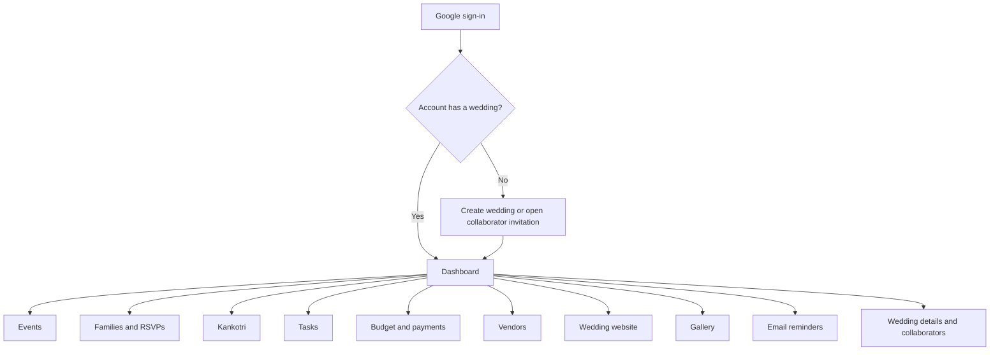
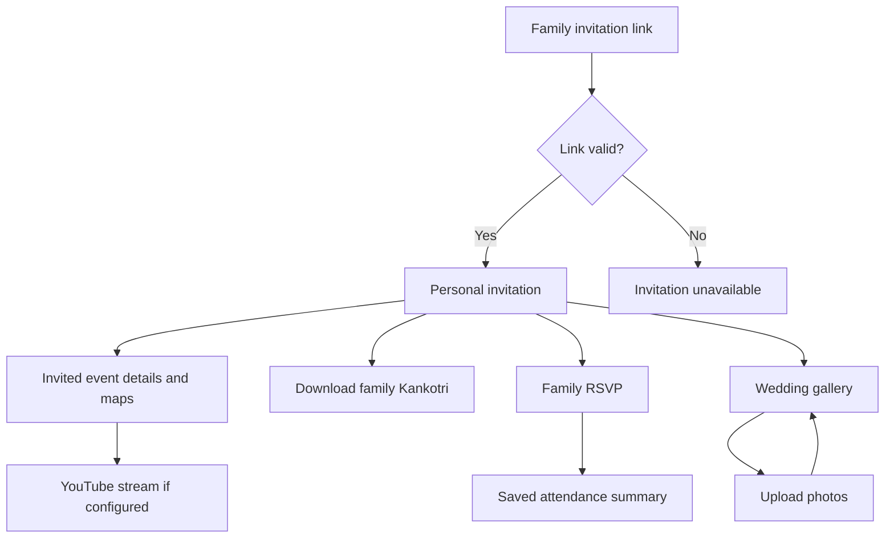
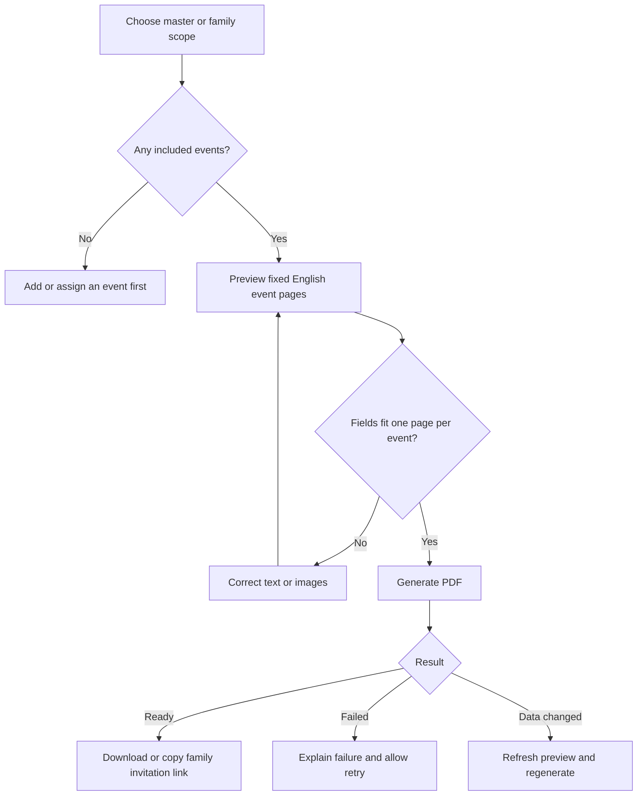

# MakeMyMarriage — User Flows and Screen Map, Version 1

**Status:** Proposed UX specification for review before wireframes  
**Version:** 1.0  
**Date:** 30 September 2026  
**Requirements:** [PRD revision 1.1](PRD-v1.md)  
**Architecture:** [System Architecture revision 1.2](System-Architecture-v1.md)

This document maps the agreed features to journeys, screens, actions, and states. Screen names, route examples, navigation, and presentation details are design proposals. They do not add features or finalize the open policies in the PRD. No application or wireframes are implemented by this document.

## 1. Rules every flow must follow

1. Workspace access uses Google sign-in only. No password, separate registration form, email login link, or password reset screen.
2. One Google account can create or join one wedding. One wedding can contain many owner/viewer accounts. No wedding switcher, leave-wedding, or self-service membership transfer.
3. Owners create and edit content and invite collaborators. They cannot delete records, remove members, or demote owners. No archive/hide/soft-delete workaround.
4. Viewers can read the workspace, including finances and receipts. Their screens do not contain editing, publishing, import, or upload controls. A task assigned to a viewer remains read-only for them.
5. Guests use a family invitation link without an account. They see only invited events and can RSVP and upload/view/download wedding photos.
6. Kankotri uses one fixed English template. Each included event has exactly one page, with couple names on that page. No cover page or template selector.
7. Automatic guest reminders use email. A family without email can still receive a manually shared invitation link and RSVP.
8. Successful guest photo uploads appear without owner approval. Neither owners nor guests have photo deletion/hiding controls.
9. The one-wedding account limit applies to workspace membership, not to unauthenticated guest invitations. Guest access never changes a workspace role.
10. Wedding websites retain two or three templates. Website template selection must not be confused with the fixed Kankotri design.

## 2. Navigation and screen hierarchy

### Planning workspace — owner and viewer

Desktop: persistent sidebar with the above destinations and a role label. Mobile: compact header and navigation drawer; keep the same labels and hierarchy. Account menu shows Google account, role, and sign out, with no wedding switching or deletion options. Details/forms open as pages or drawers according to available space; they do not need separate navigation entries.

### Guest experience

Guest navigation uses Invitation, RSVP, and Photos, with event details accessible from Invitation. No planning sidebar, financial totals, collaborator list, or Google-login prompt appears in the guest journey. A public wedding landing page, if enabled, is a separate limited entry point and never exposes family records.

## 3. Screen inventory

Paths illustrate navigational intent, not a final API or routing contract. `/app` resolves the signed-in account's single wedding; server authorization still checks the wedding scope.

### Entry and setup screens

| ID / screen | Example route | Content and actions | Access and important states |
|---|---|---|---|
| E01 — Sign in | `/login` | Continue with Google; short product introduction | Public. Loading, cancelled sign-in, provider failure. No password fields. |
| E02 — First-use landing | `/onboarding` | Create wedding; explain how to join using an emailed collaborator invitation | Authenticated and unassigned only. Do not create a wedding automatically on login. |
| E03 — Wedding setup | `/onboarding/wedding` | Couple names, wedding date, timezone, optional photos/family/host details; review and create | Unassigned account. Validation, saving, duplicate submission, account assigned elsewhere while form was open. |
| E04 — Accept collaborator invitation | `/join/{token}` | Wedding/role invitation summary after identity verification; accept; use another Google account | Matching invited Google account. Expired/revoked/used, wrong email, already in another wedding, already in same wedding. |
| E05 — Access unavailable | Context-specific | Explain unavailable resource or session expiry; retry/sign in where appropriate | Do not reveal another wedding's private details. Guest errors use G07 instead. |

### Workspace screens

| ID / screen | Example route | Main content | Owner actions / viewer experience |
|---|---|---|---|
| W01 — Dashboard | `/app` | Setup guidance, upcoming events, overdue tasks, event RSVP totals, budget/paid/outstanding, category chart | Owner shortcuts to add missing data; viewer summaries and navigation only. |
| W02 — Events | `/app/events` | Date-ordered event cards/list with venue and schedule | Owner adds events; viewer opens details. No delete menus. |
| W03 — Event details/form | `/app/events/{id}` | Name, description, date/time, optional end time, venue/address, coordinates, map link, image/theme, optional YouTube link | Owner saves edits; viewer reads details, maps, stream. Validation and unsaved-change states. |
| W04 — Families and RSVP overview | `/app/families` | Family name, invited size, side, contact, invited events, response summary; event/status filters; per-event totals | Owner adds/imports/exports and opens family records. Viewer reads/filters; bulk data-export permission is a design decision, not implied here. |
| W05 — Family details/form | `/app/families/{id}` | Contact fields, invited size, side, event selections, per-event attendance, reminder eligibility | Owner edits family, records offline RSVP, copies invitation link, requests family PDF, rotates compromised link. Viewer sees read-only details. |
| W06 — Guest import | `/app/families/import` | Template download, upload, row preview, errors, duplicate candidates, accepted-row count | Owner only. Confirm import, fix source/re-upload, retry failed commit safely. No automatic merge. |
| W07 — Kankotri centre | `/app/kankotri` | Fixed English layout preview; master/family scope; page count; generation status and latest document | Owner previews/generates/regenerates/downloads. Viewer downloads existing permitted documents, without generation controls. |
| W08 — Tasks | `/app/tasks` | Starter checklist, task list, filters; title, description, assignee, due date, event, completion | Owner creates/edits/assigns/completes. Viewer reads, even if assigned a task. |
| W09 — Vendors | `/app/vendors` | Vendor list/detail, category, contact person, phone/email, notes, related expenses/events | Owner adds/edits; viewer reads. No remove/archive actions. |
| W10 — Budget and expenses | `/app/expenses` | Budget, committed/paid/outstanding totals, category breakdown, expense list | Owner sets budget/adds expenses; viewer reads and filters. Currency/overpayment defaults remain open. |
| W11 — Expense and payment detail | `/app/expenses/{id}` | Expense amount, category, vendor/event, due date, payment history, payer, dates, receipts | Owner edits expense, adds/corrects payments, attaches receipts. Viewer views records/receipt images. No delete/detach-receipt action. |
| W12 — Wedding website | `/app/website` | Two or three templates, content preview, publication state | Owner selects template, previews, publishes/updates; viewer reads preview/state. Public visibility policy remains open. |
| W13 — Workspace gallery | `/app/gallery` | Paginated wedding photos and full-photo viewer | Members view/download. Owner upload may use the same media flow; viewers have no workspace upload control. No approval queue or removal controls. |
| W14 — Email reminders | `/app/reminders` | Upcoming reminder summary and delivery states; filters; families without email | Members read status. Owner follows links to correct family contact/schedule data; no unapproved bulk-send feature. |
| W15 — Wedding details | `/app/settings/wedding` | Couple/family/host details, photos, wedding date, timezone, welcome text | Owner edits; viewer reads. No wedding delete, ownership transfer, or leave-wedding controls. |
| W16 — Collaborators | `/app/settings/collaborators` | Member names/emails/roles; pending invitations | Owner invites/reissues/revokes pending invitations and promotes viewers. No member removal or owner demotion. Viewer reads. |

### Guest and public screens

| ID / screen | Example route | Content and actions | Access and important states |
|---|---|---|---|
| G01 — Invitation entry | `/invite/{token}` | Validate link, then open family guest session | No account needed. Token removed from visible navigation after exchange; invalid/revoked link goes to G07. |
| G02 — Personal invitation | `/guest` | Couple names, family greeting, invited event cards, RSVP summary, family PDF download | Valid family scope only. No other families or uninvited events. Empty invited-event set does not generate an empty PDF. |
| G03 — Event detail | `/guest/events/{id}` | Event date/time, image, location, directions and optional stream | Only invited event. Stream unavailable/embedding blocked shows external YouTube fallback. |
| G04 — Family RSVP | `/guest/rsvp` | One response and attendance total for each invited event; save and saved summary | Pending/attending/declined states; count validation; expired edit window according to final policy. |
| G05 — Guest gallery | `/guest/photos` | Wedding-wide photos, full-photo view, download, upload entry | Valid wedding guest access. No delete/hide controls. Gallery is not restricted to photos from invited events. |
| G06 — Photo upload | `/guest/photos/upload` | Selection preview, supported formats/limits, upload progress and per-file outcomes | Confirm selection before uploading because there is no later self-removal. Retry failed files without repeating successful uploads. |
| G07 — Guest access unavailable | `/guest/unavailable` | Link expired/replaced/unavailable; ask sender for a current invitation | No Google-login requirement and no private wedding/family information in the error page. |
| G08 — Reminder preferences | `/guest/reminders` | Current reminder preference; stop/resume guest reminders | Signed/scoped email link or valid guest session. No login and no planning access. Opening a link alone does not change the preference. |
| P01 — Public wedding page | `/w/{slug}` | Approved public couple introduction and public assets only | Conditional on final publication policy. Do not offer family-name lookup or reveal private events/gallery. |

## 4. Detailed flows

### F01 — Sign in and create a wedding

**Actor:** A couple member or organiser with no wedding membership.  
**Screens:** E01 → E02 → E03 → W01.  
**PRD:** FR-01, FR-02.

1. Choose Continue with Google and complete sign-in.
2. Existing membership opens W01. Otherwise, E02 explains Create wedding versus Join from an invitation.
3. Enter wedding setup fields. Proposed minimum: couple names, wedding date, and timezone. Optional information can be completed later.
4. Review the entered details and the one-wedding-per-account rule, then choose Create wedding. Explicit submission matters because there is no wedding deletion flow.
5. Save wedding and owner membership together; display dashboard setup guidance.

**Exceptions:** Cancellation returns to sign-in with retry. Failed creation retains the form. A concurrent create/join attempt that wins elsewhere results in a membership-conflict message and an Open my wedding action; no orphan wedding is created. Do not silently attach a user to a different wedding.

**Completion:** The account owns one saved wedding and can return to it after logout/login.

### F02 — Invite and join collaborators

**Actor:** Owner inviting another owner/viewer; recipient with matching Google email.  
**Screens:** W16 → email → E04 → W01.  
**PRD:** FR-01, FR-02.

1. Owner enters recipient email and selects Owner or Viewer.
2. Explain the selected access: owners can create/edit and cannot be removed/demoted; viewers can read finances and receipts.
3. Confirm and send the invitation. Pending invitation status appears in W16.
4. Recipient opens the invitation and signs in with the matching Google account. Preserve invitation context through login; do not send them into Create wedding automatically.
5. Recipient reviews the wedding and role and accepts. Store membership and consume invitation atomically.

**Branches:**

- Wrong Google email: show the mismatch and Use another Google account; do not expose private wedding details before identity verification.
- Account already assigned elsewhere: reject joining. Explain that another Google account requires an invitation to that other email; switching accounts alone does not satisfy an invitation addressed to the first one.
- Already a member of the same wedding: open the workspace without changing role through a duplicate invitation.
- Expired/revoked invitation: explain that the sender can reissue; previously accepted invitations cannot be used again to mutate roles.
- Promote viewer: owner confirms promotion in W16; explain that it cannot be reversed by an owner in V1.

**Completion:** Recipient reaches the correct single wedding with the assigned permissions. Logging out and using another Google account is an account change, not a wedding switcher.

### F03 — Create and edit events

**Actor:** Owner. **Screens:** W02 → W03 → W02. **PRD:** FR-03, FR-14.

Enter event details and location; preview the map link before saving. Add optional cover image and YouTube link. New events appear in date order. Event edits update the live guest pages and affected reminder schedules; existing PDFs are marked out of date and need regeneration.

**Validation:** Required name/date/start time, valid coordinates, valid end time if supplied, allowed links, image errors. Reject invalid content without losing the form. If another owner edited the event, show a conflict with reload/review rather than silently overwriting. There is no Delete event action.

### F04 — Add families and allocate events

**Actor:** Owner. **Screens:** W04 → W05, or W04 → W06 → W04. **PRD:** FR-04, FR-06.

1. Enter family name, invited size, side/group, and optional contact email/phone.
2. Select invited events and save. No RSVP is assumed merely because an invitation exists.
3. Show one row per invited event with response state and attendance total.
4. Share the personal invitation link or prepare that family's Kankotri.

**Import alternative:** Download template → upload populated file → validate/preview → review duplicate candidates and invalid rows → confirm accepted rows → show result. Invalid rows are never silently accepted. Duplicate candidates can be skipped in the import preview without deleting existing records. Retrying a confirmed import must not create duplicate families.

**Important states:** No events yet offers Add event. Missing email displays “Email reminders unavailable” without blocking creation/sharing. Invited size must be a positive whole number. Reducing size below a saved attendance count requires correcting responses first. Changing event eligibility retains history, updates reminders, and makes affected PDFs stale. No Delete family action.

### F05 — Generate and share Kankotri

**Actor:** Owner; viewer may download existing permitted documents.  
**Screens:** W07 or W05 → W07 → download/share. **PRD:** FR-05.

Master scope includes all events. Family scope includes only its invited events. Four included events must generate exactly four pages; no cover page, language selector, or template gallery appears.

States: incomplete event data, preview loading, generating, ready, failed, and out of date. Show a persistent job status so navigation does not imply the job was cancelled. Re-download rechecks access and freshness. Guest access to a not-yet-generated/outdated PDF displays a preparation/unavailable state and contact-sender guidance; guest generation is not assumed. Reminder emails link to the guest page, which remains useful even when a PDF is not ready.

Sharing a family link explains that anyone possessing it can access that family's invitation. Rotation of a compromised link requires confirmation that old links stop working. Initial guest email sending remains an open PRD item; no automatic “send all invitations” action is added here.

### F06 — Guest invitation and RSVP

**Actor:** Family guest, without registration.  
**Screens:** G01 → G02 → G03/G04 → G02. **PRD:** FR-06.

1. Open invitation and establish the family-scoped guest session.
2. View only invited events, directions, and the family PDF when ready.
3. For each event, select Attending or Not attending. Attending requires a positive whole-number family count up to invited size; Not attending stores zero. Unanswered stays Pending.
4. Review and save the response; show the saved totals by event and a clear confirmation.
5. Reopen the same invitation to see responses and edit within the final RSVP policy.

**Proposed interaction:** Save responses for the displayed events as one submission; permit unanswered events to remain pending, and explicitly identify remaining responses. Never label a partial response “All done.” Atomicity and conflict feedback should prevent an ambiguous partially saved submission.

**Exceptions:** Invalid counts show inline errors. Network failures preserve selections and allow safe retry. Concurrent family/owner edits require refreshing the saved state before resubmission. Removed event eligibility refreshes the event list without revealing other events. A deadline-closed state shows saved answers and contact-sender guidance; the actual cutoff policy remains unconfirmed.

**Owner correction:** W05 provides the same validation for recording phone/in-person responses and shows who last updated the record and when. Owners' post-deadline editing is proposed in the PRD and must be finalized before implementation.

### F07 — Plan tasks and vendors

**Actor:** Owner; viewer reads. **Screens:** W08, W09. **PRD:** FR-08, FR-09.

Use a starter checklist or add a task, choose optional assignee/event, set due date, and save. Owner marks completion; dashboard updates. Adding starter tasks again must not silently duplicate the checklist. Assigned viewers see tasks but cannot complete them.

Create vendor contacts separately, then associate vendors with expenses/events. Clickable phone/email links are available where supplied. Empty task/vendor lists offer owner creation actions and viewer informational states. Edits are available; deletion/archival is not.

### F08 — Record expenses and payments

**Actor:** Owner; viewer reads. **Screens:** W10 → W11. **PRD:** FR-10, FR-11.

1. Set wedding budget; add a committed expense with category, optional vendor/event, and due date.
2. Record a payment amount, date, payer, and optional receipt image.
3. Review saved payment and resulting outstanding balance. Example: expense 80,000 minus payment 20,000 equals 60,000 outstanding in the wedding currency.
4. Correct records by editing; recalculate totals consistently. No deletion or receipt-detach controls.

Payment saving and receipt upload need separate visible states: a failed attachment must not cause a payment to be recorded twice. Keep the saved payment and offer attachment retry. Display receipt progress/failure beside the payment. Negative/invalid amounts are rejected; overpayment policy remains open. Prevent editing a committed amount below its paid amount if the proposed no-overpayment policy is adopted. Financial conflicts preserve entered values and show the latest balance before retry.

Charts always have numeric totals and labels. Event attendee totals are not presented as unique wedding guests. Currency choice and changes after financial records exist require the documented finance policy.

### F09 — Publish wedding website and configure stream

**Actor:** Owner; viewer previews. **Screens:** W12, W03/W15; guest G03; public P01. **PRD:** FR-12, FR-14.

Choose one of two or three website templates, reuse saved couple/event data, preview, and publish/update. Changing the website template preserves saved records and does not affect the fixed Kankotri layout.

Preview distinguishes Public view from Family invitation view. Proposed family preview uses an explicitly selected family to verify its invited events; owners must not accidentally share an administrative preview URL. Do not expose private events or photos through public preview/publication. Public landing-page policy and an unpublish control remain design decisions; no unapproved control is assumed.

An owner adds a YouTube link at event level, or wedding level if the final screen design includes that placement. Guests open relevant streams from their permitted views. Show “Watch on YouTube” if embedding is unavailable; do not promise the stream is live based solely on having a URL.

### F10 — Guest photo upload and gallery

**Actor:** Guest; owners may use workspace upload; viewers read/download only.  
**Screens:** G05 → G06 → G05, or W13. **PRD:** FR-13.

1. Open gallery and choose Upload photos.
2. Show supported formats, size limits, remaining allowance if available, and the fact that photos become visible to wedding guests without approval.
3. Select photos, review the unsent selection, and confirm upload. Removing an item from the unsent local selection is not deleting an uploaded record.
4. Show per-file progress: selected → uploading → processing → published, or failed.
5. Successfully processed photos appear in the gallery immediately; failed files offer retry and a reason.

Do not publish a success count until files are ready. Navigating away during an unfinished browser upload explains that it may be interrupted; already accepted server processing can continue. Invalid/revoked guest access stops further actions. Unsupported formats, oversized files, exhausted wedding storage, and connectivity errors each need useful messages. No approval queue, delete, hide, or archive control is present. Exceptional removal is an operational policy still to be defined, not an implied app feature.

### F11 — Automatic email reminders

**Actor:** System; owners/viewers inspect status; guests set reminder preference.  
**Screens:** W14, G08, plus links to G02/G04. **PRD:** FR-07.

A due reminder checks current event eligibility, response state, email availability, and opt-out. Owner-facing statuses distinguish Scheduled, Accepted for sending, Delivered where confirmed, Failed, Skipped, and Delivery unknown. None means the message was read. Status details should explain missing email, opt-out, or stale event scheduling in plain language.

The email links to the appropriate personal invitation/RSVP and provides scoped reminder preference access. A guest can stop future reminders without losing invitation access. Do not require Google login for preferences or expose planning data. Confirm preference changes to avoid mail scanners changing them just by opening a URL.

Two-day RSVP/24-hour event schedules are proposed, not final. Whether nonresponding families receive event reminders remains open. No manual retry for an ambiguous delivery or bulk email blast is assumed; operational handling must prevent blind duplicate sends.

### F12 — Read-only viewer experience

**Actor:** Viewer. **Screens:** W01–W05, W07–W16 read views; W06 excluded. **PRD:** FR-02.

Google login opens the single workspace. Viewer browses events, guest/RSVP records, tasks, vendors, finances/receipts, website preview, reminder status, existing PDFs, and gallery. Viewer sees a clear read-only role indicator. Omit mutation controls rather than filling pages with disabled buttons. Direct visits to create/edit/import routes return a read-only/access message, not an editable form.

If an owner promotes the viewer, permissions refresh and the UI gains owner controls. A separate guest invitation can allow family RSVP/photo upload, but only in that guest context; it must not grant workspace editing rights.

## 5. Shared UI states and interaction rules

| State | Required behaviour |
|---|---|
| Initial loading | Use stable placeholders; do not flash another account/family's cached content. |
| Empty data | Explain what belongs here. Show Add actions only to owners. |
| Saving | Prevent accidental duplicate submission and retain input until outcome is known. |
| Validation error | Explain the field and correction; preserve other values and focus the first error. |
| Network/server error | Keep recoverable input and provide retry without claiming success. |
| Concurrent edit | Explain that saved information changed; let the user review current values rather than silently overwrite. |
| Unsaved form exit | Offer Stay or Discard unsaved changes. Discarding an uncommitted form is not record deletion. |
| Session expired | Workspace users reauthenticate with Google; guests reopen a valid invitation. Preserve safe navigation context. |
| Forbidden/not found | Avoid disclosing data from another wedding or family; offer navigation within current access. |
| Background operation | Persistent queued/working/ready/failed status; no indefinite spinner without recovery guidance. |
| Mobile layout | Single-column forms, readable event cards, usable number inputs, and per-file upload progress. |
| Accessibility | Label fields, support keyboard/focus navigation, announce save/upload status, and do not encode status using colour alone. |

No screens expose storage providers, queue internals, or database terminology. Use “Preparing PDF” and “Processing photo,” not infrastructure job names. Owner confirmations focus on permanent membership promotion, new wedding creation, and access-link rotation; routine edits do not require unnecessary confirmation screens.

## 6. Permissions at a glance

| Action | Owner | Viewer | Family guest |
|---|---|---|---|
| Read planning workspace and finances | Yes | Yes | No |
| Create/edit planning records | Yes | No | No |
| Delete/archive records or wedding | No | No | No |
| Invite collaborators/promote viewer | Yes | No | No |
| Remove members/demote owner | No | No | No |
| Generate Kankotri | Yes | No | No |
| Download existing PDF | Master/family | Existing master/family | Current own-family PDF only |
| Set RSVP | Any family in wedding | No | Own family, invited events |
| Upload gallery photos | Yes | No in workspace | Yes through guest access |
| View/download gallery | Yes | Yes | Wedding gallery |
| View receipts | Yes | Yes | No |
| Edit guest reminder preference | Manage family preference | No | Own family |

Policies marked open in the PRD, such as deadlines, still apply. Guest access is a separate capability, not a workspace role change.

## 7. Requirements coverage

| PRD requirement | Screens | Flow |
|---|---|---|
| FR-01 Authentication/setup | E01–E04, W15 | F01, F02 |
| FR-02 Roles/single wedding | E04–E05, W16; all protected screens | F01, F02, F12 |
| FR-03 Events | W02–W03, G02–G03 | F03 |
| FR-04 Families | W04–W06 | F04 |
| FR-05 Kankotri | W05, W07, G02 | F05 |
| FR-06 RSVP | W04–W05, G04 | F06 |
| FR-07 Reminders | W14, G08 | F11 |
| FR-08 Tasks | W08, W01 | F07 |
| FR-09 Vendors | W09, W11 | F07 |
| FR-10 Finances | W10–W11 | F08 |
| FR-11 Dashboard | W01 | F01, F06–F08 |
| FR-12 Website | W12, P01, G02 | F09 |
| FR-13 Gallery | W13, G05–G06 | F10 |
| FR-14 YouTube | W03/W15, G03 | F09 |

## 8. Decisions to settle during wireframe review

| Decision | Proposed direction / impact |
|---|---|
| Public website content and publication controls | Limited couple introduction; invited events and gallery remain private. Confirm public/unpublish behaviour. |
| RSVP deadline and partial submission | Show per-event responses and pending items; confirm deadline behaviour and the proposed Save responses interaction. |
| Reminder schedule and eligible recipients | Keep exact timings configurable until confirmed; decide treatment of unanswered RSVPs. |
| Initial guest invitation email | Manual link/PDF sharing is included; sending initial guest emails is not yet confirmed. |
| Currency, overpayments, correction of mistaken records | Confirm rules before finance forms; no delete/void/archive workaround is introduced. |
| Photo formats, limits, retention and exceptional removal | Display actual supported limits once decided; do not promise unlimited storage or self-removal. |
| Viewer bulk export | Existing downloads/read access included; confirm whether guest-list spreadsheet export belongs in viewer actions. |
| Wedding-level stream field | Event stream field is covered; choose final placement for an optional wedding-wide stream. |

These are refinements or existing open policies, not reasons to redesign the confirmed role, account, or invitation model.

## 9. Wireframe sequence and review checklist

Create mobile and desktop wireframes in this order:

1. E01–E04 and W01: sign-in, create/join, account conflicts, dashboard.
2. W02–W07 and G01–G04: events, families, fixed Kankotri, personal invitation, and RSVP. This is the core product journey.
3. W13 and G05–G06: gallery and upload states, including the no-removal rule.
4. W08–W11: planning and finances with receipts and correction states.
5. W12, W14–W16, G08, and conditional P01: website, reminders, settings, and collaborators.

Review with sample data: five events; one family invited to two; one family without email; attending/declined/pending responses; two owners and a viewer; an organiser account already assigned elsewhere; a partially paid vendor expense; and a mixed-success photo upload.

Before accepting wireframes, verify:

- No password login, wedding switcher, owner demotion, member removal, record deletion, Gujarati Kankotri, cover page, or Kankotri template selector appears.
- Each family sees only its invited events and corresponding PDF pages.
- Guest RSVP and photo upload require no account.
- Viewer screens are read-only, including assigned tasks and gallery upload.
- Every async/error/empty state has a clear next action appropriate to the user's access.
- All FR-01 through FR-14 requirements have a screen and flow.
- Open policies are visibly marked, rather than treated as approved design decisions.
